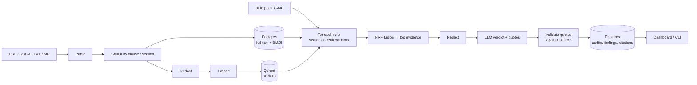

# compliance-rag

Audit contracts, employment agreements and financial reports against a checklist of rules, and get a verdict for each rule backed by **verbatim quotes from the source document**.

Most RAG demos answer questions. This one makes compliance judgements, and it is built so the LLM can't bluff. Every finding must cite exact text from the retrieved evidence. Any quote that can't be found in the source is thrown out, and a "compliant" verdict with no surviving evidence is downgraded to `missing_evidence`.

## Features

- **Templates or custom checklists.** Pick one of five built-in rule packs, or write your own checklist in the dashboard and save it as a template. Packs are version-controlled YAML, so new audit types need no code (see [Rule packs](#rule-packs)).
- **Live results.** Each checklist item appears with its verdict and quoted evidence as soon as it completes.
- **Hybrid retrieval.** Dense vector search (Qdrant) and BM25 keyword search (Postgres full-text) are merged with Reciprocal Rank Fusion. Clause wording like "restraint of trade" is found even when embeddings miss it.
- **Structure-aware chunking.** Documents are split on clause and section headings, so citations point to a page and section rather than an arbitrary slice of text. Tables are kept whole.
- **Quote validation.** Each citation is checked against the stored chunk text before it is saved (see [Guardrails](#guardrails)).
- **Per-document audits.** Retrieval is limited to the document under audit, so evidence can't leak in from other files.
- **Redaction before any API call.** ID and phone numbers, email addresses and currency amounts are masked before text is sent for embedding or judgement.
- **Provider-agnostic.** Gemini or OpenAI via [LiteLLM](https://github.com/BerriAI/litellm), switched with one environment variable.
- **Dashboard and CLI.** A Streamlit dashboard (upload → checklist → live results, plus audit history) and a Typer CLI for the same operations.

## Architecture



The full document text is stored only in your local Postgres. Only redacted text is sent to the embedding and LLM APIs.

For the full design (data model, retrieval and validation details, security model, trade-offs and known limitations), see **[docs/ARCHITECTURE.md](docs/ARCHITECTURE.md)**.

## Quick start

Requires Docker and a Gemini or OpenAI API key.

```bash
cp .env.example .env        # then add your API key (see below)
docker compose up -d --build
```

Open **http://localhost:8501**. This starts three containers: Postgres, Qdrant and the dashboard.

### Choosing a provider

In `.env`, set `LLM_PROVIDER` and the key for that provider:

```ini
LLM_PROVIDER=gemini         # or: openai
GEMINI_API_KEY=...
OPENAI_API_KEY=...
```

| Provider | Embeddings | Judgement model |
|---|---|---|
| `gemini` (default) | `gemini-embedding-001` (3072-d) | `gemini-2.5-flash` |
| `openai` | `text-embedding-3-small` (1536-d) | `gpt-4o-mini` |

Each provider has its own vector collection, because the embedding sizes differ. After switching provider, re-ingest your documents.

After editing `.env`, run `docker compose up -d` so the container picks up the change.

## Usage

### Dashboard

1. **Upload** a contract, policy or report. It's indexed automatically. Uploading the same file again is detected and reuses the existing index.
2. **Pick a checklist.** Choose a **Template**, or switch to **Custom** and list your own checks (what to verify, severity, optional search phrases). **Save as template** writes it to `rules/` for reuse.
3. **Run.** A progress bar tracks the checks, and each one appears with its verdict, explanation and quoted evidence as soon as it completes. Items that failed or lack evidence open automatically.

Every run is saved. **Overview** shows the compliance score and the breakdown by status and severity; **Findings** lets you filter past results and open the full passage behind each quote.

### CLI

```bash
docker compose exec dashboard python -m compliance_rag.cli ingest uploads
docker compose exec dashboard python -m compliance_rag.cli docs        # list doc_ids
docker compose exec dashboard python -m compliance_rag.cli search "notice period" --doc <doc_id>
docker compose exec dashboard python -m compliance_rag.cli audit rules rules/mna_contract.yaml
docker compose exec dashboard python -m compliance_rag.cli audit run rules/mna_contract.yaml --doc <doc_id>
docker compose exec dashboard python -m compliance_rag.cli audit findings --audit <audit_id>
```

## Rule packs

| Pack | Rules | Covers |
|---|---|---|
| `general_contract` | 4 | Governing law, liability cap, non-compete ≤ 12 months, breach notification deadline |
| `mna_contract` | 12 | Parties, consideration, closing, conditions precedent, reps & warranties, indemnity, termination, liability cap, governing law, disputes, confidentiality, restrictive covenants |
| `financial_report` | 10 | Revenue, net income, EBITDA, cash flow, debt, risk factors, auditor opinion, going concern, related parties, guidance |
| `employment_contract` | 10 | Role, compensation, benefits, start date, probation, notice, IP assignment, non-compete, termination grounds, governing law |
| `employment_za` | 4 | South African employment basics: hours and pay, probation, annual leave, notice |

Each rule produces one of four verdicts:

| Status | Meaning |
|---|---|
| `compliant` | Satisfied, with verified quotes |
| `non_compliant` | Violated, or a required clause is absent |
| `missing_evidence` | Not enough evidence retrieved to judge |
| `not_applicable` | An optional clause (e.g. a non-compete) is not present |

## Guardrails

The LLM's output is treated as a claim to verify, not an answer:

1. **Evidence-only prompting.** The model judges only the retrieved evidence, must quote it verbatim, and returns strict JSON at temperature 0.
2. **Source check.** A citation that points to a chunk that wasn't retrieved for the rule is dropped.
3. **Quote check.** Each quote is compared with a span of the same length in the source, after normalising case, whitespace and curly quotes. A quote may use `...` to skip text, but its parts must appear in order. Omitted words cost score, so "shall not exceed" can't pass as "shall exceed". The redacted text the model saw is checked as well as the original.
4. **No unverified verdicts.** A `compliant` or `non_compliant` verdict whose quotes all fail the check is downgraded to `missing_evidence`, with confidence capped at 0.4.
5. **Absence claims are kept and labelled.** A missing clause has nothing to quote, so `non_compliant` with no citations is stored as an absence claim, together with the searches that failed to find the clause, so a reviewer can judge whether retrieval missed it.
6. **Per-document scope.** Audits only retrieve chunks from the selected document.

These guardrails are covered by unit tests in `tests/test_validate.py`.

## Writing a rule

The easiest way is the **Custom** checklist builder in the dashboard. To write YAML by hand, drop a file into `rules/`. The folder is mounted into the container, so it appears in the dashboard straight away, with no rebuild.

```yaml
meta:
  pack_id: my_pack
  version: 0.1.0

rules:
  - rule_id: MY-NOTICE-001        # must be unique across all packs
    domain: employment            # legal | financial | employment
    description: "Notice period specified"
    severity: high                # high | medium | low
    evidence_required: true
    retrieval_hints:              # search queries used to find evidence
      - "notice period terminate by giving notice"
    check_prompt: >
      Determine whether the contract specifies a notice period.
      Quote the clause. If absent, mark non_compliant.
```

## Project structure

```
src/compliance_rag/
  ingestion/   parsers.py      PDF (pdfplumber), DOCX, TXT/MD → pages + tables
  chunking/    splitter.py     heading-aware clause chunks, sliding window for long sections
  security/    redaction.py    PII / amount masking before any API call
  indexing/    embeddings.py   LiteLLM embeddings
               store.py        Qdrant upsert + Postgres chunk storage
  retrieval/   search.py       dense + BM25 hybrid search, RRF fusion
  audit/       rules.py        YAML rule pack loader
               llm.py          prompt building + LLM verdict
               validate.py     verbatim quote validation
               runner.py       orchestrates an audit, persists findings
  storage/     db.py           Postgres schema
  cli/         app.py          Typer CLI
  config.py    all tunables (models, chunk sizes, retrieval depth, thresholds)
dashboard/app.py               Streamlit UI
rules/                         rule packs (YAML)
tests/                         unit tests for the validation gate
```

## Local development

Docker runs the full app. For running the CLI or tests directly, or for editor autocompletion:

```bash
python3 -m venv .venv && source .venv/bin/activate
pip install -r requirements.txt
export PYTHONPATH=src
pytest tests/
```

When run outside Docker, the code connects to Postgres and Qdrant on `localhost`, so keep `docker compose up` running. The app doesn't load `.env` itself, so export your API key in the shell first.

## Limitations

- **Redaction is regex-based.** It catches structured PII such as IDs, emails and amounts, but not personal names. Named-entity recognition is the obvious next step.
- **No OCR.** Scanned PDFs with no text layer are flagged and skipped.
- **Domain routing is by filename** (e.g. "invoice" → financial). Ingestion records a domain for each document but doesn't yet use it to filter audits.
- **No authentication** on the dashboard. It is intended for local use.

## Tech stack

Python 3.12 · LiteLLM · Qdrant · PostgreSQL 16 · Streamlit · Typer · pdfplumber · Docker Compose
