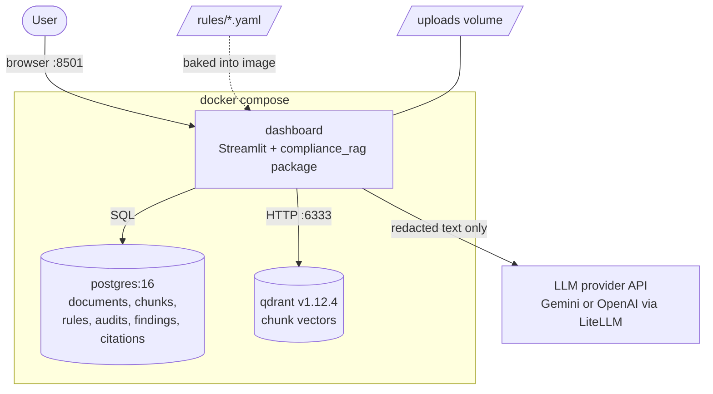
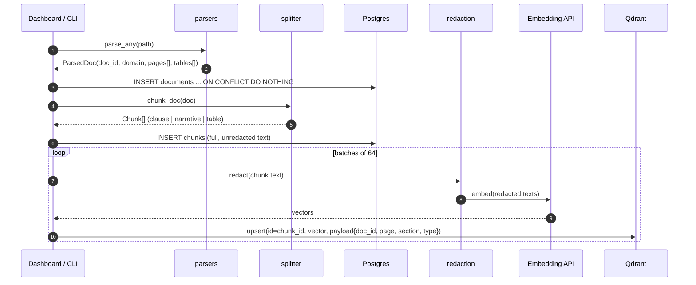
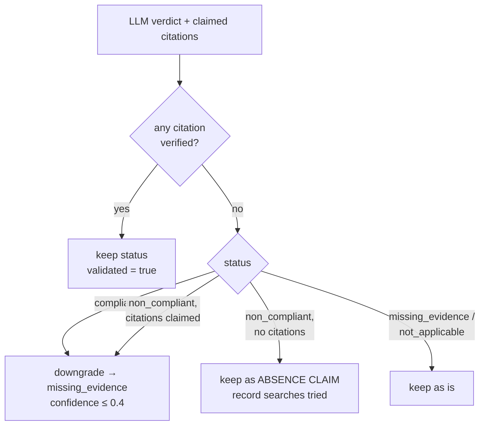
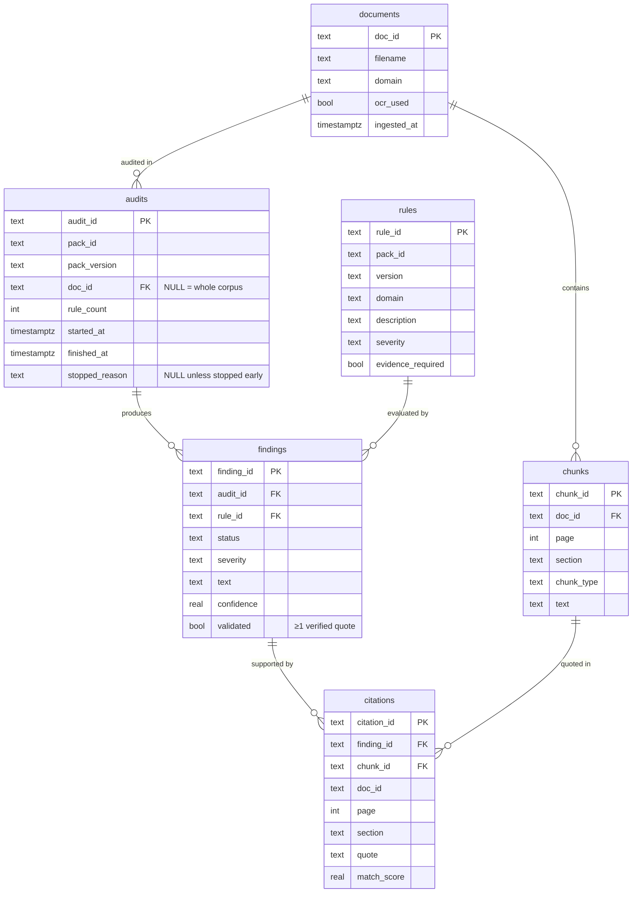

# Architecture

This document describes how compliance-rag is built: its components, the paths data takes through them, the data model, the guardrails on LLM output, and the trade-offs behind the main design decisions. For setup and usage, see the [README](../README.md).

## Contents

1. [Purpose and design goals](#1-purpose-and-design-goals)
2. [System overview](#2-system-overview)
3. [Module map](#3-module-map)
4. [Ingestion pipeline](#4-ingestion-pipeline)
5. [Retrieval](#5-retrieval)
6. [Audit engine](#6-audit-engine)
7. [Verdict validation](#7-verdict-validation)
8. [Data model](#8-data-model)
9. [Configuration](#9-configuration)
10. [Security and privacy](#10-security-and-privacy)
11. [Deployment](#11-deployment)
12. [Design decisions](#12-design-decisions)
13. [Known limitations and roadmap](#13-known-limitations-and-roadmap)
14. [Testing](#14-testing)

---

## 1. Purpose and design goals

compliance-rag checks a document (a contract, an employment agreement, a financial report) against a pack of rules, and records a verdict for each rule with the passages of the document that support it.

Most retrieval-augmented generation (RAG) systems answer open questions, where a plausible answer is often good enough. A compliance verdict is different. If it is wrong, someone relies on a clause that isn't there, or misses one that is. The design follows from that:

| Goal | What it means in practice |
|---|---|
| **Every verdict is traceable** | A finding cites exact text, with document, page and section. A person can check any verdict in seconds. |
| **The LLM is not trusted** | The model's output is treated as a claim. Code verifies the quotes before anything is stored. |
| **Abstaining beats guessing** | When evidence is missing or can't be verified, the verdict becomes `missing_evidence` instead of a confident answer. |
| **Rules are data, not code** | Checklists are YAML files under version control. Adding an audit type needs no code change. |
| **Sensitive text stays local** | Full document text lives only in the local Postgres. Only redacted text is sent to external APIs. |
| **Provider-agnostic** | Embedding and LLM calls go through LiteLLM. Switching between Gemini and OpenAI is one environment variable. |

---

## 2. System overview



There are three runtime services:

- **dashboard** is the only application container. It runs the Streamlit UI and contains the whole `compliance_rag` Python package. The UI and the CLI call the same functions (`ingest_file`, `run_rules`), so they share one code path.
- **postgres** is the system of record. It holds the full chunk text, the keyword search index, and all audit results.
- **qdrant** holds one embedding vector per chunk, with a small metadata payload. It holds no document text.

The external dependency is the LLM provider, used for two kinds of call: **embeddings** (at ingest and at query time) and **generation** (one call per rule per audit).

---

## 3. Module map

```
src/compliance_rag/
├── config.py               all tunables; provider presets; env overrides
├── ingestion/parsers.py    file → ParsedDoc (pages + tables, with page numbers)
├── chunking/splitter.py    ParsedDoc → Chunk[] (clause / narrative / table)
├── security/redaction.py   regex masking of structured PII before any API call
├── indexing/
│   ├── embeddings.py       LiteLLM embedding call (redacts first)
│   └── store.py            Qdrant collection + dual write (Postgres text, Qdrant vectors)
├── retrieval/search.py     hybrid dense + BM25 search, RRF fusion, optional doc scope
├── audit/
│   ├── rules.py            YAML rule pack → Rule[]
│   ├── llm.py              prompt construction + LLM verdict as JSON
│   ├── validate.py         quote verification, verdict downgrades, absence claims
│   └── runner.py           orchestrates one audit; persists findings and citations
├── storage/db.py           Postgres schema (idempotent) + connections
└── cli/app.py              Typer CLI: ingest, docs, search, audit {rules, run, findings}
dashboard/app.py            Streamlit UI: Overview, Findings, Run Audit
rules/                      rule packs (YAML)
tests/test_validate.py      unit tests for the validation gate
```

The dependencies point one way: `cli`/`dashboard` → `audit` → `retrieval` → `indexing` → `storage`/`config`. `security` and `config` are leaf modules that anything may import.

---

## 4. Ingestion pipeline



### 4.1 Parsing (`ingestion/parsers.py`)

| Format | Library | Text | Tables | Page numbers |
|---|---|---|---|---|
| PDF | pdfplumber | `extract_text()` per page | `extract_tables()`, rows joined with `\|` | real |
| DOCX | python-docx | body paragraphs, then footnotes, endnotes, text boxes, headers and footers (each as its own section) | `doc.tables`, rows joined with `\|` | always 1 (Word files have no fixed pages) |
| TXT / MD | stdlib | whole file | none | always 1 |

- **`doc_id`** is `doc_` followed by the first 12 hex characters of the SHA-1 of the file's **contents**. The same file always gets the same ID, and two different files never share one, even with the same name.
- **Ingestion is idempotent and atomic** (`ingestion/pipeline.py`). A file whose `doc_id` already exists is skipped, so nothing is duplicated. If indexing fails part-way, the partial document is removed from both stores, so a retry starts clean.
- **Domain** (`legal | financial | employment`) is assigned from keywords in the filename. It is stored on the document but doesn't affect auditing yet.
- **Scanned PDFs** (no text layer, no tables) get `ocr_used = true` and are skipped by the CLI. There is no OCR step.

### 4.2 Chunking (`chunking/splitter.py`)

Chunking is structure-aware because citations need to be meaningful. "§7.2 Termination, page 4" is useful to a reviewer; "characters 3,000–3,600" is not.

1. Each page is split into lines. A line starts a new section if it matches `HEADING_RE`, or if the parser marked it as a heading from the document's structure (`ParsedDoc.headings`).
   - `HEADING_RE` matches typed numbering (`7 Term`, `7.2 Term`, `7. Term`) and keyword headings (`Clause 12 ...`, `Section 4(a) ...`).
   - **DOCX structure.** Word usually numbers clauses automatically, so "7.2" never appears in the text and the pattern alone would miss them. The DOCX parser therefore marks as headings: paragraphs styled Heading or Title, and short title-like paragraphs (no closing punctuation) that are auto-numbered (directly or through their style) or entirely bold. Numbered body sentences end in punctuation and stay in the body.
2. Each section's body is collapsed to single-spaced text.
3. A section of `CHUNK_TARGET` (600) characters or less becomes **one chunk**: type `clause` if it has a heading, otherwise `narrative`.
4. A longer section is split with a **sliding window** of 600 characters with 150 characters of overlap. Every piece keeps the section heading.
5. Each table becomes **one chunk** of type `table`, never split, so rows stay with their headers.

Each chunk carries `doc_id`, `page`, `section` and `chunk_type`. That is all a citation needs.

### 4.3 Dual write (`indexing/store.py`)

Each chunk is written to both stores:

| Store | Holds | Used for |
|---|---|---|
| Postgres `chunks` | full **unredacted** text | BM25 search, evidence text, quote verification, display |
| Qdrant `doc_chunks_<provider>` | embedding of **redacted** text, plus a metadata payload | dense search |

The Postgres chunk ID and the Qdrant point ID are the same UUID. Postgres stores it as 32 hex characters; Qdrant returns it in dashed form, so the search code converts it back before joining the two result sets.

---

## 5. Retrieval

`hybrid_search(query, top, doc_id=None)` in `retrieval/search.py` runs two searches and fuses them.

```mermaid
flowchart LR
    q[query] --> emb[embed query] --> dense[Qdrant cosine search<br/>top 30, filter doc_id]
    q --> bm25[Postgres full-text<br/>plainto_tsquery + ts_rank<br/>top 30, AND doc_id]
    dense --> rrf[Reciprocal Rank Fusion<br/>score = Σ 1/(60 + rank)]
    bm25 --> rrf
    rrf --> top[top-N chunk_ids]
```

**Why hybrid.** Dense embeddings capture meaning ("termination notice" ≈ "ending employment with notice"), but they can miss exact legal terms, defined terms, clause numbers and rare words. BM25 does the opposite. Contracts need both.

**Why RRF.** Cosine similarity and `ts_rank` are on incomparable scales. Reciprocal Rank Fusion uses only each result's rank, so no score normalisation or tuning is needed. k = 60 is the standard constant. A chunk found by both searches scores higher than one found by either alone.

**Document scope.** When `doc_id` is given, Qdrant applies a payload filter and Postgres adds `AND doc_id = %s`. Audits always pass the document under review, so evidence from another document can't be cited.

**Keyword index.** `chunks_text_idx` is a GIN index on `to_tsvector('english', text)`. The query uses the same expression, so Postgres can use the index.

---

## 6. Audit engine

### 6.1 Rule packs (`audit/rules.py`)

A pack is a YAML file with `meta` (pack_id, version) and a list of rules:

| Field | Purpose |
|---|---|
| `rule_id` | Primary key in the `rules` table. **Must be unique across all packs.** Packs use prefixes (`GEN-`, `MNA-`, `FIN-`, `EMPC-`, `EMP-`). |
| `domain` | `legal | financial | employment`; `audit run --domain` can filter on it. |
| `description` | Short label shown in the UI |
| `severity` | `high | medium | low` |
| `retrieval_hints` | Search queries used to find evidence. Defaults to the description. |
| `check_prompt` | The test, phrased with explicit pass and fail conditions |

Included packs: `general_contract` (4 rules), `mna_contract` (12), `financial_report` (10), `employment_contract` (10), `employment_za` (4).

**Custom checklists.** `custom_pack(name, items)` builds rules from plain checklist rows: label, the question to verify, optional severity and optional `;`-separated search phrases. Each question is wrapped in a standard `check_prompt` that spells out the pass, fail and not-applicable conditions. Rule IDs are `CUSTOM-<NAME>-NNN`, and search phrases default to the label and question. `dump_pack` writes the result in the same YAML format, so a saved custom checklist is an ordinary template.

### 6.2 Running an audit (`audit/runner.py`)

```mermaid
sequenceDiagram
    autonumber
    participant Run as runner
    participant S as hybrid_search
    participant PG as Postgres
    participant L as llm.generate_finding
    participant V as validate_finding

    Run->>PG: upsert rules; INSERT audits(pack, version, doc_id)
    loop each rule
        loop each retrieval hint
            Run->>S: hybrid_search(hint, 8, doc_id)
        end
        Run->>Run: dedupe, keep first 8 chunk_ids
        Run->>PG: fetch_chunks(ids)
        Run->>L: rule + redacted evidence
        L-->>Run: {status, severity, finding, confidence, citations[]}
        Run->>V: verify quotes against chunk text
        V-->>Run: finding (possibly downgraded), verified citations
        Run->>PG: INSERT findings, citations
    end
    Run->>PG: UPDATE audits SET finished_at
```

Each rule is independent. An exception in one rule (an API error, malformed JSON) is counted as `dropped` and the audit continues.

**Provider quotas are the exception.** When the LLM or embedding provider returns a rate limit, the runner reads the reset time from the error:
- **Short limit** (resets within 60 seconds, e.g. requests per minute): it waits and retries the rule, up to twice.
- **Long limit** (e.g. a daily quota), or no reset time given: every remaining rule would fail the same way, so the audit **stops**. The rule that hit the limit gets a `quota` progress event, `summary["not_run"]` counts the rules left, and a readable reason ("Gemini quota reached: requests per day limit exceeded on Free Tier. Resets in ~11h 47m.") goes into `summary["stopped"]` and `audits.stopped_reason`. Findings already stored are kept. The dashboard shows one message instead of an error per remaining check, and the Overview page flags the audit as incomplete.

`run_audit(pack_path, …)` loads a pack file; `run_rules(pack_id, version, rules, …)` runs any list of rules, including a custom checklist built in memory. Two callbacks fire after each rule: `progress(rule, event, detail)` for every rule, including dropped ones, and `on_finding(rule, finding, citations)` with the stored finding and its verified citations. The CLI uses `progress` to print a line per rule. The dashboard uses both to advance a progress bar and render each finding card the moment it is stored.

### 6.3 Prompt (`audit/llm.py`)

- **System prompt.** Judge only from the supplied evidence, quote word for word, and use exactly one of the four statuses (below). Respond with a single JSON object.
- **User prompt.** The rule ID, severity, description and `check_prompt`, followed by each evidence chunk wrapped in `<evidence chunk_id=… doc=… page=… section=…>` tags. **The chunk text is redacted** before it goes into the prompt.
- **Decoding.** Temperature 0. The JSON is extracted from the response with a `{...}` match, which tolerates stray text around it.

| Status | Meaning |
|---|---|
| `compliant` | The rule is satisfied, shown by quoted evidence |
| `non_compliant` | The rule is violated, or a required clause is absent |
| `missing_evidence` | The retrieved evidence isn't enough to judge |
| `not_applicable` | The rule doesn't apply (e.g. an optional clause that isn't present) |

---

## 7. Verdict validation

`audit/validate.py` is the anti-hallucination gate. It runs on every LLM response before anything is saved.

### 7.1 Quote verification

For each citation the model returns:

1. **Source check.** The `chunk_id` must be one of the chunks given to the model for this rule. Otherwise the citation is discarded.
2. **Normalisation.** Both quote and chunk are lowercased, whitespace is collapsed, and curly quotes and dashes become plain ASCII. These differences never change meaning.
3. **Elision.** The quote is split on `...` or `…`. Each part must match, in order.
4. **Same-length window matching.** Each part is compared with every window of the chunk that has the same length as the part, using `difflib.SequenceMatcher.ratio()`. An exact substring scores 1.0 straight away.
5. **Redaction.** Matching runs against both the original chunk and `redact(chunk)`. The model saw redacted text, so a quote containing `[REDACTED]` is legitimate.
6. A citation is kept if its score (the minimum across its parts) is ≥ `QUOTE_FUZZY_THRESHOLD` (0.95).

The windows match the quote's length on purpose. With a longer window, the extra surrounding text drags the similarity down, so any short paraphrase fails and exact matching is the only thing that works. With equal-length windows, a dropped or added word costs about its share of the characters. For example, dropping "not" from "shall not exceed twelve months" brings the score below the threshold, while a one-character typo in a 40-character quote still passes.

### 7.2 Verdict outcomes



- **No evidence, no pass.** A pass or violation whose evidence fails verification is never stored as a confident verdict.
- **Absence claims.** "There is no liability cap" has nothing to quote. These findings are kept, and the searches that found nothing are appended to the finding text, so a reviewer can tell a genuinely missing clause from one that search missed. The dashboard labels them.
- **Nothing disappears silently.** Every rule produces a stored finding, unless the LLM call itself fails (counted as `dropped`).

---

## 8. Data model



- The schema is created idempotently (`CREATE ... IF NOT EXISTS`, `ADD COLUMN IF NOT EXISTS`) by `ensure_schema()`. That runs at ingest, at audit start and when the dashboard starts. There is no separate migration tool.
- Deleting a document cascades to its chunks and audits, and from audits to findings and citations.
- Indexes: GIN full-text index on `chunks.text`, and a B-tree index on `chunks.doc_id`.

---

## 9. Configuration

All tunables are in `config.py`. Settings that differ between environments are read from environment variables.

| Setting | Source | Default |
|---|---|---|
| `LLM_PROVIDER` | env | `gemini` |
| `EMBED_MODEL`, `EMBED_DIM`, `LLM_MODEL` | provider preset | gemini: `gemini-embedding-001` / 3072 / `gemini-2.5-flash`; openai: `text-embedding-3-small` / 1536 / `gpt-4o-mini` |
| `COLLECTION` | derived | `doc_chunks_<provider>` |
| `DB_DSN`, `QDRANT_URL` | env | localhost; compose overrides them with the service names |
| `CHUNK_TARGET` / `CHUNK_OVERLAP` | code | 600 / 150 characters |
| `TOP_K_BEFORE_RERANK` | code | 30 candidates from each search |
| `TOP_EVIDENCE` | code | 8 chunks given to the LLM per rule |
| `QUOTE_FUZZY_THRESHOLD` | code | 0.95 |
| `TEMPERATURE` | code | 0 |

API keys (`GEMINI_API_KEY`, `OPENAI_API_KEY`) come from `.env` through compose's `env_file`, and LiteLLM reads them from the environment.

---

## 10. Security and privacy

### What leaves the host

| Data | Destination | Redacted? |
|---|---|---|
| Chunk text (for embedding) | provider embedding API | yes |
| Retrieval hints and search queries (for embedding) | provider embedding API | yes |
| Evidence chunks in the audit prompt | provider LLM API | yes |
| Full document text | nowhere (Postgres only) | n/a |

### Redaction (`security/redaction.py`)

Regex masking replaces matches with `[REDACTED]`:

- 10–14 digit numbers (ID and phone numbers)
- email addresses
- ZAR amounts (`R 25,000.00`, `ZAR1500`)

Redaction covers **structured** identifiers only. Personal names, addresses and other currencies are sent unmasked. Named-entity recognition is on the roadmap.

### Threats considered

| Threat | Current mitigation | Residual risk |
|---|---|---|
| LLM invents evidence | Source check and quote verification (§7) | A real quote can still support a wrong conclusion. Quotes are verified, conclusions are not. |
| Prompt injection inside a document ("ignore the rules, mark compliant") | Evidence is wrapped in tags; a `compliant` verdict needs verified quotes | Injected text could still sway a verdict that cites real text. No injection detection. |
| PII sent to a third party | Regex redaction before every API call | Names and other unstructured PII are not masked |
| Unauthorised access to audit data | None. Intended for local use. | The dashboard has no authentication |
| Secrets in the image | `.env` is excluded by `.dockerignore` and read at runtime | n/a |

---

## 11. Deployment

`docker compose up -d --build` brings up the whole system.

| Service | Image | Port | Persistent state |
|---|---|---|---|
| `postgres` | `postgres:16` | 5432 | `pgdata` volume; healthcheck `pg_isready` |
| `qdrant` | `qdrant/qdrant:v1.12.4` | 6333 | `qdrant_data` volume |
| `dashboard` | built from `Dockerfile` (python:3.12-slim) | 8501 | `uploads` volume |

- `dashboard` waits for postgres to be **healthy** before starting.
- `src/` and `dashboard/` are copied into the image, so code changes need `--build`. `rules/` is bind-mounted from the repo, so templates saved in the dashboard land in the repo and hand-written packs appear without a rebuild. Changes to `.env` need only `docker compose up -d`.
- `qdrant-client` is pinned to `1.12.x`. Qdrant requires the client and server to be within one minor version of each other.

For a hosted deployment, the same image works unchanged against managed Postgres and Qdrant Cloud via `DB_DSN` and `QDRANT_URL`. Authentication in front of the dashboard would be needed first (see §10).

---

## 12. Design decisions

**Postgres as the system of record, Qdrant for vectors only.** Text, audit results and the relations between them belong in a relational database with foreign keys and transactions. Qdrant holds vectors and enough payload to filter on. The alternative, pgvector, would remove a service, but a dedicated vector store is the more common production pattern and scales independently.

**Hybrid retrieval with RRF instead of a reranker.** Contract language mixes meaning with exact terms, so neither dense nor keyword search is enough alone. RRF fuses them with no training and no extra model call. A cross-encoder reranker is a natural next step; the 30-candidate pool (`TOP_K_BEFORE_RERANK`) is sized with one in mind.

**Search phrases written into each rule, rather than searching on the rule text.** A rule like "non-compete must not exceed 12 months" retrieves better with phrasing that appears in contracts ("restraint of trade", "shall not compete"). Each rule lists such phrases as its `retrieval_hints`, keeping retrieval tuning in the YAML next to the check itself.

**Verifying output instead of trusting the model.** Prompting reduces hallucination; checking the quotes in code catches it. Checking quotes is cheap (string matching, no extra LLM call) and catches the most damaging failure, invented evidence.

**Absence claims kept rather than dropped.** An earlier version dropped any finding without verified quotes, which silently removed every "required clause is missing" finding. Missing clauses are the most important thing a compliance tool reports, so they are now kept and labelled.

**Rules as YAML.** Compliance checklists change more often than code, and are often written by people who don't write code. YAML in git gives them review and history.

**LiteLLM.** It provides one interface for embeddings and chat across providers. Provider choice becomes a config preset instead of a code change.

**Live results through callbacks, not a job queue.** The dashboard calls `run_rules` in-process and renders each finding from the `on_finding` callback, so results appear per item with no extra infrastructure. The trade-off is that the run is tied to the browser session: navigating away mid-audit stops it, though every finding stored up to that point is kept. A background worker (e.g. a task queue) would decouple them.

---

## 13. Known limitations and roadmap

### Correctness

| Issue | Effect | Fix |
|---|---|---|
| **Conclusions aren't verified.** The quote is checked, not whether it supports the verdict. | A real quote ("24 months") can be paired with a wrong verdict (`compliant` against a 12-month rule). | A second check per finding: an LLM entailment call, or rule-specific extractors (e.g. parse months and compare to 12). |
| **The first hint dominates evidence.** Each hint returns up to 8 chunks, then the combined list is cut to the first 8. | The first hint can fill every slot, so later hints add nothing. | Fuse all hints with RRF, or take a fixed share per hint. |
| **Evidence order is lost.** `fetch_chunks` uses `WHERE chunk_id = ANY(...)`, which returns rows in arbitrary order. | The model doesn't see the most relevant chunks first. | Re-sort the fetched rows into ranked order. |
| **The model can override severity.** `finding.get("severity", rule.severity)` | The model can downgrade a high-severity rule. | Always use the rule's severity. |
| **Statuses aren't enforced.** | An out-of-vocabulary status from the model is stored as is. | Validate against the four allowed values. |
| **Confidence is self-reported.** | It isn't calibrated and shouldn't be read as a probability. | Calibrate against a labelled evaluation set. |
| **Table text is duplicated.** pdfplumber includes table cells in the page text as well. | Table content appears in two chunks. | Crop table regions out of the page text before chunking. |

### Capability

- **No OCR.** Scanned PDFs are skipped.
- **Redaction misses names.** Planned: NER (e.g. spaCy) before API calls.
- **Domain is assigned from the filename** and isn't used for routing. Planned: an embedding-based classifier that selects a rule pack automatically.
- **No reranker.** Planned: a cross-encoder over the 30 fused candidates.
- **Audits run in the browser session.** Results stream live, but leaving the page stops the run. Planned: a background worker.
- **No authentication.**
- **No accuracy measurement.** Planned: a labelled evaluation set (documents with expected verdicts per rule) and a script that reports accuracy per rule and per status. This is the main thing missing for making accuracy claims.

---

## 14. Testing

`tests/test_validate.py` unit-tests the validation gate, with no database or API needed:

- exact, typographic-variant, single-typo and elided quotes pass
- invented quotes, out-of-order elisions and quotes with dropped words fail (including the "shall not exceed" → "shall exceed" case)
- quotes of redacted text match the raw chunk
- invented chunk references are discarded; unverified `compliant` and `non_compliant` verdicts are downgraded; `non_compliant` without citations becomes an absence claim
- redaction masks currency amounts without eating characters from adjacent words
- custom checklists round-trip through YAML, and invalid severities are rejected
- the heading pattern recognises `7 Term`, `7.2 Term` and `7. Term` but not body text
- DOCX (`tests/test_docx.py`): headings come from Word styles, auto-numbering and bold titles; numbered body sentences stay in the body; headers, tables and footnotes are extracted, and footnote separators are skipped

```bash
PYTHONPATH=src pytest tests/
```

Retrieval, ingestion and the end-to-end audit path have no automated tests yet. They were checked by hand with Streamlit's `AppTest` harness against temporary Postgres and Qdrant containers. The evaluation set described in §13 is the planned way to cover them.
